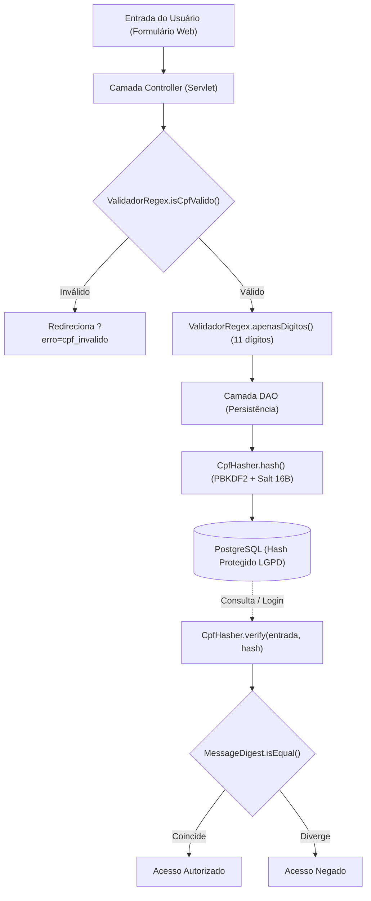

# Documentação Acadêmica: Criptografia, Hash e Conformidade LGPD para Dados Sensíveis (CPF)

Este documento apresenta uma análise conceitual, técnica e acadêmica sobre os mecanismos de **criptografia aplicada, funções de derivação de chave (KDF)** e **anonimização/pseudonimização** implementados no sistema **Efficientia** para a proteção de dados pessoais (especificamente o Cadastro de Pessoa Física - CPF), alinhando-se aos princípios da **Lei Geral de Proteção de Dados (Lei nº 13.709/2018 - LGPD)** e às boas práticas de Engenharia de Software e Segurança da Informação.

---

## 1. Contexto e Motivação Acadêmica

### 1.1. O Problema da Persistência de Dados em Texto Claro (Plaintext)
Em sistemas legados de gestão e transporte, identificadores de pessoas físicas (como o CPF) costumam ser armazenados diretamente em texto plano (`VARCHAR(11)` ou `CHAR(11)`). Em caso de violação de dados (*data breach*), injeção de SQL (*SQL Injection*) ou acesso indevido a *backups*, essas informações são expostas imediatamente, acarretando:
* Sanções administrativas e financeiras previstas na LGPD (Art. 52).
* Risco de falsidade ideológica, fraudes financeiras e roubo de identidade para o titular dos dados.

### 1.2. Princípios da LGPD Atendidos
A implementação do componente `CpfHasher` contempla pilares fundamentais da LGPD:
1. **Segurança (Art. 6º, VII):** Uso de medidas técnicas e administrativas aptas a proteger os dados pessoais de acessos não autorizados.
2. **Prevenção (Art. 6º, VIII):** Adoção de medidas prévias para evitar a ocorrência de danos em virtude do tratamento de dados.
3. **Privacidade por Padrão (*Privacy by Design & by Default* - Art. 46):** A proteção do dado ocorre na camada de serviço/utilitário antes da persistência no banco de dados.

---

## 2. Tecnologias e Mecanismos Criptográficos Utilizados

A classe [CpfHasher](Efficientia/src/main/java/com/efficientia/efficientia/util/CpfHasher.java) utiliza a API nativa de segurança do Java (`javax.crypto` e `java.security`), sem dependências externas adicionais, baseando-se nas seguintes tecnologias:

### 2.1. PBKDF2 (*Password-Based Key Derivation Function 2*) com HMAC-SHA-256
* **Definição:** Especificado pelo RFC 2898 (PKCS #5 v2.0) e pelo NIST (SP 800-132), o **PBKDF2** é um algoritmo de derivação de chave projetado para mitigar ataques de força bruta (*brute-force*) e ataques baseados em tabelas pré-computadas (*Rainbow Tables*).
* **Função Pseudoaleatória Subjacente (PRF):** Utiliza-se `HMAC-SHA256` (*Hash-based Message Authentication Code* sobre SHA-256), que combina uma função de dispersão criptográfica de 256 bits com uma chave secreta/dado derivado.
* **Custo Computacional (*Key Stretching*):** Configurado com **600.000 iterações**. Esse atraso deliberado inviabiliza ataques em larga escala via hardware especializado (GPUs e ASICs), tornando o custo de adivinhação do CPF astronomicamente alto para atacantes externos.

### 2.2. Geração Criptográfica de Salt Individual (`SecureRandom`)
* **Problema dos Hashes Puros (SHA-256 simples):** Como o espaço amostral do CPF é finito ($10^{11}$ combinações possíveis, ou ~100 milhões de CPFs válidos), um hash rápido como MD5 ou SHA-256 puro poderia ser quebrado em minutos usando tabelas arco-íris (*rainbow tables*).
* **Solução:** Para cada CPF inserido, é gerado um **Salt criptográfico de 16 bytes (128 bits)** através da classe `java.security.SecureRandom`.
* **Resultado:** Dois usuários com o mesmo CPF geram representações de hash completamente diferentes na base de dados, eliminando a correlação direta e prevenindo ataques de dicionário.

### 2.3. Comparação em Tempo Constante (`MessageDigest.isEqual`)
* **Vulnerabilidade Evitada (*Timing Attacks*):** Métodos convencionais como `String.equals()` encerram a comparação no primeiro caractere divergente, permitindo que atacantes descubram o conteúdo medindo variações de nanossegundos na resposta do servidor.
* **Mecanismo:** A validação em `CpfHasher.verify(...)` utiliza `MessageDigest.isEqual(...)`, que executa uma comparação em tempo estritamente constante (*Constant-Time Equality Check*), protegendo a aplicação contra ataques de temporização baseados em canal lateral (*Side-Channel Attacks*).

### 2.4. Codificação e Formato do Artefato de Armazenamento
O hash é serializado em uma estrutura autossuficiente compatível com o padrão Unix modular crypt format:
```text
pbkdf2-sha256$600000$<salt_base64>$<hash_base64>
```
* `pbkdf2-sha256`: Identificador do algoritmo para interoperabilidade futura.
* `600000`: Quantidade de iterações aplicada (permite evolução futura para parâmetros mais fortes).
* `<salt_base64>`: Salt aleatório de 16 bytes codificado em Base64 (24 caracteres).
* `<hash_base64>`: Hash de 32 bytes (256 bits) derivado codificado em Base64 (44 caracteres).

---

## 3. Relação entre REGEX, Modelagem de Banco e Hashes Criptográficos

Um dos aspectos acadêmicos mais ricos desta implementação é o estudo de como a criptografia impacta outras camadas do sistema:

### 3.1. Expressões Regulares (REGEX) vs. Hashing
Existe uma distinção conceitual e temporal crucial entre as operações:
1. **Fase de Entrada (Validação e Sanitização):**
   * O usuário digita o CPF no formulário web.
   * O [ValidadorRegex](Efficientia/src/main/java/com/efficientia/efficientia/util/ValidadorRegex.java) valida a sintaxe através da expressão regular `^(\d{3}\.\d{3}\.\d{3}-\d{2}|\d{11})$`.
   * A função `ValidadorRegex.apenasDigitos(cpf)` remove a máscara, produzindo os 11 caracteres numéricos.
2. **Fase de Transformação (Hashing):**
   * O hash PBKDF2 é gerado **apenas após a aprovação do REGEX**.
   * O hash final contém caracteres alfanuméricos e símbolos (`$`, `/`, `+`), medindo cerca de 88 a 92 caracteres. **Nunca deve ser submetido ao REGEX de CPF**, pois causaria falso-negativo.

### 3.2. Desafio da Busca Indexada e Soluções em Ciência da Computação
* Hashes probabilísticos com salt individual impedem consultas SQL clássicas como:
  ```sql
  WHERE cpf LIKE '%123%' -- Inviabilizado pelo salt criptográfico
  ```
* **Abordagens Acadêmicas para Tratamento:**
  1. **Verificação em Memória:** Para conferência pontual (ex.: login ou confirmação de identidade), utiliza-se `CpfHasher.verify(cpfInformado, cpfArmazenado)`.
  2. **Hash Cego / HMAC Determinístico (*Blind Index*):** Para buscas exatas rápidas no banco sem expor o dado em claro, a literatura recomenda manter um campo auxiliar (ex.: `cpf_index`) calculado via HMAC com chave secreta do servidor, permitindo `WHERE cpf_index = ?` mantendo a segurança do dado real.

### 3.3. Adaptação do Modelo e Banco de Dados
* No PostgreSQL, a tipagem original `CHAR(11)` com restrição `CHECK (length(cpf) = 11)` é desenhada para CPFs em texto plano.
* Para acomodar o hash de proteção LGPD, o campo deve ser dimensionado como `VARCHAR(128)`, e os models Java (`PecuaristaModel`, `AnalistaModel`) adaptam sua normalização defensiva para não truncar valores identificados por `CpfHasher.isHashed()`.

---

## 4. Diagrama da Arquitetura de Segurança



---

## 5. Conclusão Acadêmica

A implementação da proteção de CPF no projeto **Efficientia** demonstra a aplicação prática de conceitos de:
* **Criptografia Aplicada e KDFs:** Mitigação de vulnerabilidades com PBKDF2 e salts únicos.
* **Engenharia de Software Segura (*Secure Coding*):** Eliminação de *timing attacks* e isolamento de responsabilidades entre validação de entrada (REGEX) e persistência segura (Hash).
* **Conformidade Regulatória:** Transição do armazenamento inseguro para modelos em conformidade com as diretrizes da LGPD para dados pessoais sensíveis e identificadores unívocos.
