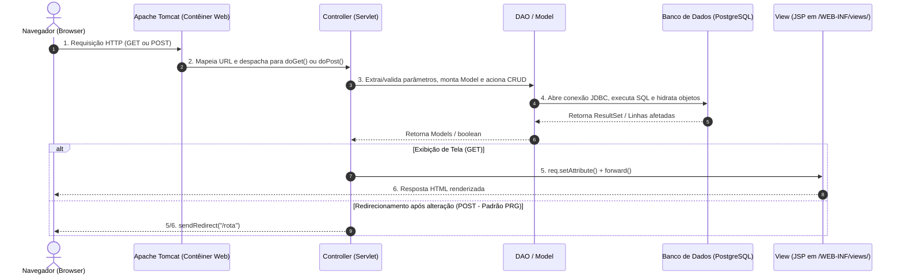

# Guia Passo a Passo: Desenvolvimento de Servlets e Arquitetura MVC com Jakarta EE

Baseado nas diretrizes de P.O.O. Interdisciplinar e no Projeto **Efficientia**.

---

## 1. Arquitetura MVC e o Fluxo de Requisição

A arquitetura **MVC (Model-View-Controller)** divide a aplicação em camadas bem definidas com responsabilidades isoladas:



---

## 2. Papéis de Cada Componente

### MODEL (Entidades de Negócio)
- Representa as informações e regras do domínio (ex: `TrajetoModel`, `MotoristaModel`, `CaminhaoModel`, `PecuaristaModel`, `StatusTrajeto`).
- Possui construtores sobrecarregados:
  - **Sem ID:** Para instanciar novos objetos antes de salvar no banco (`CREATE`).
  - **Com ID:** Para instanciar objetos já existentes recuperados do banco (`READ` / `UPDATE`).

### DAO (Data Access Object)
- Isola todo o acesso a dados e comandos SQL. Nunca mistura regras de interface.
- Implementa os métodos CRUD padronizados:
  - `boolean inserir(Model m)` &rarr; executa `INSERT INTO ...`
  - `List<Model> listar()` &rarr; executa `SELECT * FROM ...`
  - `Model buscar(int id)` &rarr; executa `SELECT * FROM ... WHERE id = ?`
  - `boolean atualizar(Model m, int id)` &rarr; executa `UPDATE ... WHERE id = ?`
  - `boolean excluir(int id)` &rarr; executa `DELETE FROM ... WHERE id = ?`

### VIEW (Páginas JSP sob `/WEB-INF/views/`)
- Responsável pela exibição para o usuário.
- Fica dentro de `/WEB-INF/` para **impedir o acesso direto pelo navegador** sem passar pelo Controller.
- Utiliza JSTL (`<c:forEach>`, `<c:if>`, `<c:out>`) e Expression Language (`${variavel}`) para renderizar os dados enviados pelo Servlet.

### CONTROLLER (Servlets)
- O maestro do sistema. Herda de `HttpServlet`, anota com `@WebServlet` e:
  - Recebe os parâmetros da requisição (`HttpServletRequest`).
  - Converte Strings em tipos primitivos, datas e referências de objetos.
  - Invoca o DAO correspondente.
  - Decide se faz `forward` (exibição de tela) ou `sendRedirect` (após alteração via POST).

---

## 3. Configuração do Ambiente e `pom.xml`

Para configurar um projeto Jakarta EE no IntelliJ / Maven:

1. Criar projeto Jakarta EE com template **"Web application"**.
2. Ajustar `pom.xml` para Java 21:
   ```xml
   <maven.compiler.source>21</maven.compiler.source>
   <maven.compiler.target>21</maven.compiler.target>
   ```
3. Adicionar dependências essenciais:
   - **Jakarta EE Web API** (`jakarta.jakartaee-web-api`) com escopo `provided`.
   - **Driver do PostgreSQL** (`org.postgresql:postgresql`).
   - **JSTL API** (`jakarta.servlet.jsp.jstl-api:3.0.2`).
   - **Implementação JSTL** (`org.glassfish.web:jakarta.servlet.jsp.jstl:3.0.1`).
4. Configurar Apache Tomcat 11:
   - *Run > Edit Configurations > + > Tomcat Server > Local*.
   - Aba *Deployment > + > Artifact > "nome-projeto: war exploded"*.
   - *Application Context:* `"/"` ou `"/Efficientia"`.

---

## 4. A Importância dos Métodos Extras/Auxiliares nos Servlets

No `TrajetoServlet` e nos demais Servlets adequados do projeto Efficientia, utilizamos métodos utilitários privados no final da classe (ex.: `buscarPecuarista`, `buscarMotorista`, `buscarEmpresa`, `obterParametro`, `parseLocalDate`, `parseInt`).

### Por que eles são fundamentais?

1. **Resolução de Relacionamentos (Chaves Estrangeiras em POO):**  
   O protocolo HTTP só trafega texto. Do formulário chega apenas o ID (ex: `idPecuarista="3"`). O `TrajetoModel` precisa do objeto `PecuaristaModel` completo. O método `buscarPecuarista(req)` extrai o ID da requisição e chama `pecuaristaDAO.buscar(id)`, retornando o objeto pronto.

2. **Evita Duplicação de Código (Princípio DRY - *Don't Repeat Yourself*):**  
   Tanto no método de cadastro quanto no de atualização (`atualizar`), os mesmos parâmetros precisam ser extraídos e convertidos. Sem os métodos auxiliares, o código fica duplicado, longo e suscetível a inconsistências.

3. **Resiliência e Tratamento Seguro de Exceções (Adeus Erro 500):**  
   Se o usuário enviar um campo numérico vazio ou data inválida, chamar diretamente `Integer.parseInt()` estoura `NumberFormatException` e derruba o Tomcat com erro HTTP 500. Os métodos auxiliares `parseInt()` e `parseLocalDate()` capturam a exceção, gravam o log e retornam um valor padrão seguro ou `null`.

4. **Flexibilidade de Nomes de Parâmetros:**  
   O método `obterParametro(req, "dataNascimento", "data_nascimento")` permite que tanto formulários com camelCase quanto formulários com snake_case funcionem sem quebrar.

5. **Código Limpo e Alta Coesão:**  
   `doGet()` e `doPost()` tornam-se pequenos, legíveis e focados puramente na orquestração:
   - Recebe requisição
   - Delega conversões para métodos auxiliares
   - Chama o DAO
   - Redireciona ou despacha (`forward`)

---

## 5. Estrutura Padrão de um Servlet (Padrão `TrajetoServlet`)

Abaixo está o esqueleto padronizado que deve ser seguido por qualquer Servlet:

```java
package com.efficientia.efficientia.controller;

import jakarta.servlet.ServletException;
import jakarta.servlet.annotation.WebServlet;
import jakarta.servlet.http.HttpServlet;
import jakarta.servlet.http.HttpServletRequest;
import jakarta.servlet.http.HttpServletResponse;
import java.io.IOException;
import java.util.List;

@WebServlet(name = "ExemploServlet", value = "/exemplo")
public class ExemploServlet extends HttpServlet {

    private ExemploDAO dao;

    @Override
    public void init() {
        // Inicializado uma única vez pelo Tomcat no ciclo de vida
        dao = new ExemploDAO();
    }

    // ==================== GET: CONSULTAS E TELAS ====================
    @Override
    protected void doGet(HttpServletRequest req, HttpServletResponse resp)
            throws ServletException, IOException {

        String acao = req.getParameter("acao");

        // 1. Rota para carregar tela de edição
        if ("editar".equals(acao)) {
            try {
                int id = parseInt(req.getParameter("id"), 0);
                ExemploModel model = dao.buscar(id);

                if (model != null) {
                    req.setAttribute("exemploModel", model);
                    req.setAttribute("exemplo", model);
                    req.getRequestDispatcher("/WEB-INF/views/editar-exemplo.jsp")
                       .forward(req, resp);
                    return;
                }
            } catch (Exception e) {
                System.out.println("Erro ao buscar para edição: " + e.getMessage());
            }
        }

        // 2. Rota padrão: carregar listagem
        List<ExemploModel> lista = dao.listar();
        req.setAttribute("exemplos", lista);
        req.setAttribute("exemploModels", lista);

        req.getRequestDispatcher("/WEB-INF/views/exemplo.jsp")
           .forward(req, resp);
    }

    // ==================== POST: AÇÕES DE ALTERAÇÃO ====================
    @Override
    protected void doPost(HttpServletRequest req, HttpServletResponse resp)
            throws IOException {

        // Garante suporte a caracteres com acentuação
        req.setCharacterEncoding("UTF-8");

        String acao = req.getParameter("acao");

        // 1. Exclusão (DELETE)
        if ("excluir".equals(acao)) {
            try {
                int id = parseInt(req.getParameter("id"), 0);
                dao.excluir(id);
            } catch (Exception e) {
                System.out.println("Erro ao excluir: " + e.getMessage());
            }
            resp.sendRedirect(req.getContextPath() + "/exemplo");
            return;
        }

        // 2. Atualização (UPDATE)
        if ("atualizar".equals(acao)) {
            try {
                int id = parseInt(req.getParameter("id"), 0);
                String campo1 = obterParametro(req, "campo1");
                int campo2 = parseInt(obterParametro(req, "campo2"), 0);

                ExemploModel model = new ExemploModel(id, campo1, campo2);
                dao.atualizar(model, id);
            } catch (Exception e) {
                System.out.println("Erro ao atualizar: " + e.getMessage());
            }
            resp.sendRedirect(req.getContextPath() + "/exemplo");
            return;
        }

        // 3. Cadastro Padrão (CREATE)
        String campo1 = obterParametro(req, "campo1");
        int campo2 = parseInt(obterParametro(req, "campo2"), 0);

        ExemploModel novo = new ExemploModel(campo1, campo2);
        dao.inserir(novo);

        // Padrão Post-Redirect-Get (PRG): impede reenvio duplo ao dar F5
        resp.sendRedirect(req.getContextPath() + "/exemplo");
    }

    // ==================== MÉTODOS AUXILIARES ====================
    private String obterParametro(HttpServletRequest req, String... nomes) {
        for (String nome : nomes) {
            String valor = req.getParameter(nome);
            if (valor != null && !valor.isBlank()) {
                return valor;
            }
        }
        return null;
    }

    private int parseInt(String texto, int padrao) {
        if (texto == null || texto.isBlank()) return padrao;
        try {
            return Integer.parseInt(texto.trim());
        } catch (Exception e) {
            System.out.println("Erro parse int: " + e.getMessage());
            return padrao;
        }
    }
}
```

---

## 6. Padrão das Views (JSP)

1. **Cabeçalho obrigatório para JSTL:**
   ```jsp
   <%@ taglib prefix="c" uri="jakarta.tags.core" %>
   ```

2. **Formulário de Cadastro:**
   ```jsp
   <form action="${pageContext.request.contextPath}/exemplo" method="post">
       <!-- Não precisa de campo 'acao', pois cairá no fluxo padrão do doPost -->
       <input type="text" name="campo1" required />
       <button type="submit">Cadastrar</button>
   </form>
   ```

3. **Botão de Exclusão na Tabela:**
   ```jsp
   <form action="${pageContext.request.contextPath}/exemplo" method="post" style="display:inline;">
       <input type="hidden" name="acao" value="excluir" />
       <input type="hidden" name="id" value="${item.id}" />
       <button type="submit" onclick="return confirm('Deseja realmente excluir?')">Excluir</button>
   </form>
   ```

4. **Link de Edição na Tabela:**
   ```jsp
   <a href="${pageContext.request.contextPath}/exemplo?acao=editar&id=${item.id}">Editar</a>
   ```

5. **Formulário de Edição (`editar-exemplo.jsp`):**
   ```jsp
   <form action="${pageContext.request.contextPath}/exemplo" method="post">
       <input type="hidden" name="acao" value="atualizar" />
       <input type="hidden" name="id" value="${exemplo.id}" />
       <input type="text" name="campo1" value="<c:out value='${exemplo.campo1}'/>" required />
       <button type="submit">Salvar alterações</button>
       <a href="${pageContext.request.contextPath}/exemplo">Cancelar</a>
   </form>
   ```

---

## 7. Dicas e Resolução de Erros Frequentes

- **Erro 404 ao tentar acessar a JSP diretamente:**  
  As JSPs dentro de `/WEB-INF/` não podem ser acessadas digitando a URL no navegador. O acesso **DEVE** ocorrer sempre pela rota do Servlet (ex: `/trajeto`, `/motorista`).

- **Reenvio duplicado de formulário ao pressionar F5:**  
  Nunca use `forward()` após um `POST`. Sempre use `sendRedirect()`, seguindo o padrão **Post-Redirect-Get (PRG)**.

- **Erro *"Artifact todo-list:war exploded not found"* ou alterações que não aparecem:**  
  1. Acesse *File > Project Structure > Artifacts*.
  2. Verifique se a opção *"Include in Project build"* está marcada.
  3. Vá no menu *Build > Build Artifacts > Selecione "war exploded" > Clique em Rebuild*.
  4. Reinicie o Tomcat.

- **Erro *"Driver do PostgreSQL não encontrado"*:**  
  Certifique-se de que a dependência `org.postgresql:postgresql` está no `pom.xml` e que na inicialização (`ConnectionFactory`) é executado o carregamento dinâmico:
  ```java
  Class.forName("org.postgresql.Driver");
  ```
